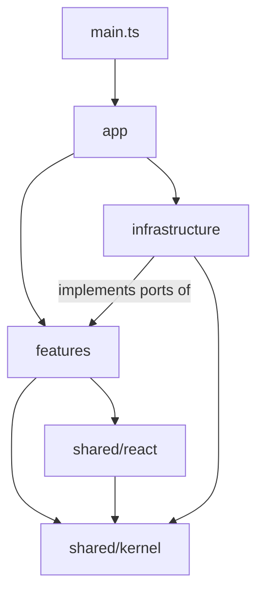

# Architecture

Second Brain OS is one Obsidian plugin that combines three tools:

| Source idea                                                                                                                              | What it becomes here                                                                                                     |
| ---------------------------------------------------------------------------------------------------------------------------------------- | ------------------------------------------------------------------------------------------------------------------------ |
| [Day Planner](https://github.com/ivan-lednev/obsidian-day-planner)                                                                       | **Planner**: a timeline of time-blocked tasks, a multi-day view, and time tracking (**clocks**)                          |
| [Calendar](https://github.com/liamcain/obsidian-calendar-plugin) + [Periodic Notes](https://github.com/liamcain/obsidian-periodic-notes) | **Periodic**: daily to yearly notes, a month calendar, and navigation                                                    |
| Pillars, Pipelines & Vaults (PPV, after August Bradley)                                                                                  | **PPV**: pillars, goals, projects and tasks as linked notes, plus **rollups** (progress) and **lint** (structure checks) |

The plugin stores everything as plain Markdown and front matter. Removing it leaves a readable vault.

## Goals and constraints

- **One plugin, one settings tab, one model.** A task scheduled in the planner is the same task that rolls up into a project and appears in the weekly review.
- **Markdown is the database.** No hidden store. Any derived data (indexes, rollups) can be rebuilt from the vault.
- **Lean on proven plugins.** Tasks owns task statuses and toggling (including recurrence), Templater renders templates. The setup gate (`src/features/setup`) blocks features until both are installed, enabled and new enough. The plugin keeps its own task index (ADR 0002), so Dataview is optional.
- **Mobile works.** `isDesktopOnly: false`, so no Node or Electron APIs at runtime. Lint blocks them.
- **Small and fast.** `main.js` budget is 400 KB (`scripts/check-bundle.ts`). Plugin load stays under 50 ms of our own work. Index work runs after `onLayoutReady`.

## Layers

```
src/
  main.ts               Plugin class. Calls app/ and nothing else.
  app/                  Composition root: container, lifecycle, feature list.
  features/<feature>/   Vertical slices (setup, periodic, calendar, planner, clocks, ppv, rollups, lint).
    domain/             Pure types and rules. No obsidian, no React.
    application/        Use cases and ports (interfaces). No obsidian, no React, no UI.
    ui/                 React components and Obsidian views, modals, settings sections.
    index.ts            The feature's public API. The only file other modules may import.
  infrastructure/<adapter>/  Implements ports against Obsidian, Tasks and Templater.
  shared/kernel/        Result, Store, version maths. Pure.
  shared/react/         ReactItemView, ErrorBoundary, hooks, service context.
  styles/               CSS, scoped with the `sbos-` prefix, using Obsidian's CSS variables.
```

Allowed dependencies. ESLint enforces these with `eslint-plugin-boundaries` and import restrictions, so a wrong import fails CI:

| From                     | May import                                                             |
| ------------------------ | ---------------------------------------------------------------------- |
| `main.ts`                | `app`                                                                  |
| `app`                    | everything (it is the wiring)                                          |
| `features/*`             | other features' `index.ts`, `shared/react`, `shared/kernel`            |
| `features/*/domain`      | its own domain, `shared/kernel` only                                   |
| `features/*/application` | its own domain and application, `shared/kernel`                        |
| `infrastructure/*`       | other adapters, features' `index.ts` (for port types), `shared/kernel` |
| `shared/react`           | `shared/kernel`                                                        |
| `shared/kernel`          | nothing else                                                           |



### Ports and adapters

Each feature declares what it needs from the outside world as interfaces in `application/ports.ts`. `infrastructure/` implements them. `app/container.ts` is the only place they meet. Tests swap in fakes from `tests/fakes/`.

| Port                                                                            | Adapter                    | Wraps                                     |
| ------------------------------------------------------------------------------- | -------------------------- | ----------------------------------------- |
| `PluginRegistry`                                                                | `infrastructure/obsidian`  | `app.plugins`                             |
| `NoteStore` (list, read, create, `process`, front matter, links, change events) | `infrastructure/obsidian`  | `app.vault`, `app.metadataCache`          |
| `TaskToggler` (toggle done, including recurrence)                               | `infrastructure/tasks`     | Tasks `apiV1`                             |
| `TemplateEngine`                                                                | `infrastructure/templater` | Templater                                 |
| `Clock`, `DateFormatter`, `Workspace`, `Notifier`                               | `infrastructure/obsidian`  | Date, `moment`, `app.workspace`, `Notice` |
| `RemoteCalendar` (read-only ICS)                                                | `infrastructure/ics`       | `requestUrl`                              |
| `SettingsPersistence`                                                           | `infrastructure/settings`  | `loadData` and `saveData`                 |

## Core domain model

All features share these types, defined in each owning feature's `domain/` and exported from its `index.ts`.

- **Period**: `{ granularity: day | week | month | quarter | year, start }`. Owned by `periodic`. Resolves to a note path from per-granularity format, folder and template settings.
- **Task**: a Markdown task line identified by `path + line + text hash`. Status comes from Tasks. Optional **time block** (`10:00 - 11:30` at the start of the text, Day Planner syntax) and optional scheduled date (Tasks' `⏳`).
- **Clock entry**: a child list item under a task, `[clock::2026-10-29T10:00--2026-10-29T11:15]`. An open entry has no end. Owned by `clocks`.
- **PPV entities**: notes typed by front matter `type:` with links upward.
    - `pillar`: an area of life you maintain, with no end date.
    - `goal`: a value goal or an outcome goal. Links to a `pillar`.
    - `project`: has a status (`backlog | active | paused | done | dropped`), dates, and a link to a `goal` or `pillar`.
    - Tasks belong to a project by living in the project note, or by linking to it.
    - **Pipelines** are the flows that move work: capture, then project, then schedule into a periodic note, then do (planner), then review (periodic reviews). **Vaults** are reference notes (`type: resource`, journals, archives).
- **Rollup**: derived numbers (done/total tasks, clocked time, last activity) per project, goal and pillar, computed from the index. Never written back except into the optional `progress` front matter field when the user turns it on.
- **Lint finding**: `{ rule, severity, path, line?, message, fix? }`, such as a project without a parent, a goal linked to a missing pillar, an overdue active project, or a malformed time block.

## Runtime flow

1. `onload`: build the container, load and migrate settings (zod schema plus versioned migrations, never overwriting unreadable data), and register the setup view and command.
2. `onLayoutReady`: evaluate the dependency gate. If not ready, open the setup view. Features register only once the gate reports ready, and register once.
3. Each `FeatureModule.register` adds its views, commands, settings section, code block processors and event subscriptions through `plugin.register*`, so unload cleans up everything.
4. Reads go through the `TaskIndex` and `PeriodicNotes` index, kept current from vault events and exposed as a `Store`. Views subscribe with `useStore`.
5. Writes go through `NoteStore.process` (atomic read-modify-write) with pure edit functions from the domain, such as `moveTimeBlock(line, start, end) => line`. That makes every write testable without Obsidian.

## Cross-cutting decisions

| Topic         | Decision                                                                                                                                                               |
| ------------- | ---------------------------------------------------------------------------------------------------------------------------------------------------------------------- |
| UI            | React 19 in `ReactItemView`. Each view has an `ErrorBoundary`, so a crash shows a message instead of a blank pane. Obsidian CSS variables only, no hard-coded colours. |
| State         | `Store<T>` (kernel) plus `useSyncExternalStore`. No global state library.                                                                                              |
| Errors        | `Result<T, E>` for expected failures. A `Notice` for the user only at UI edges. No `console` in `src/`.                                                                |
| Settings      | One zod schema with a section per feature, `version` plus ordered migrations, and a test per migration.                                                                |
| Dates         | `window.moment` from Obsidian, never bundled. Locale and week start follow settings.                                                                                   |
| Public API    | `plugin.api` keeps the old Periodic Notes API (`getPeriodicNote`, `createPeriodicNote`, `getGranularities`) and adds planner and PPV queries. Semver applies to it.    |
| Compatibility | `minAppVersion` in `manifest.json`. The `obsidian` dev dependency is pinned to that version.                                                                           |
| Accessibility | jsx-a11y lint, keyboard paths for every pointer action (drag has a command equivalent), ARIA labels on icon buttons.                                                   |
| Security      | No `eval` or `innerHTML` with note content. Remote calendars are read-only and fetched with `requestUrl`. No telemetry.                                                |

## Architecture decision records

Decisions that change this document get a short ADR in `docs/adr/NNNN-title.md` (context, decision, consequences) in the same pull request.
