# Development lifecycle

Every check that CI runs is a `make` target. If `make ci` passes on your machine, the pipeline will pass too.

```mermaid
flowchart LR
  idea[Issue] -->|Definition of Ready| ready[ready label]
  ready --> branch[Branch off main]
  branch --> pr[Pull request]
  pr -->|CI, review, Definition of Done| main[main]
  main -->|make version + make release| tag[Tag x.y.z]
  tag -->|release workflow| draft[Draft release]
  draft -->|smoke test, publish| users[Users]
```



## 1. Plan

- Work starts as a GitHub issue from a template (feature or bug). Each one names a feature ID from [features.md](features.md).
- An issue gets the `ready` label once it meets the [Definition of Ready](definition-of-ready-and-done.md#definition-of-ready).
- Milestones match the roadmap phases (`2.0.0-alpha.1`, …).
- Architecture changes start with an ADR in `docs/adr/`.

## 2. Develop

```bash
make install                  # dependencies from bun.lock
make dev                      # watch build into dist/
make link VAULT=~/DevVault    # symlink dist/ into a vault's plugins folder
```

- Install the Hot Reload community plugin in the dev vault. The watch build writes `dist/.hotreload`.
- Branch names: `<type>/<feature-id>-<slug>`, for example `feat/pln-3-drag-blocks`.
- Commit often. Pull requests are squash-merged, so the PR title becomes the commit on `main`.

## 3. Verify locally

```bash
make check    # format-check, lint, typecheck, coverage, build, check-bundle
make format   # fix formatting
```

## 4. Pull request

- Title in Conventional Commits form: `feat(planner): drag to resize blocks`. The `PR title` workflow checks it.
- The PR template's checklist is the [Definition of Done](definition-of-ready-and-done.md#definition-of-done).
- Keep PRs small (around 400 lines of code, excluding tests).

## 5. Continuous integration

| Workflow       | Trigger                                           | Jobs                                                                                                                                                                                                                        |
| -------------- | ------------------------------------------------- | --------------------------------------------------------------------------------------------------------------------------------------------------------------------------------------------------------------------------- |
| `ci.yml`       | every PR, push to `main`, called by `release.yml` | **quality**: `make format-check lint typecheck`. **test**: `make coverage` and upload lcov. **build**: `make check-bundle` and upload the plugin files. **dependency-review**: PRs only, fails on high-severity advisories. |
| `pr-title.yml` | PR opened or edited                               | Conventional Commits title check                                                                                                                                                                                            |
| `codeql.yml`   | PR to `main`, push to `main`, weekly              | CodeQL for JavaScript and TypeScript                                                                                                                                                                                        |
| `release.yml`  | tag `x.y.z`, or manual with a tag                 | Reruns CI, checks the tag against `manifest.json`, `package.json` and `versions.json`, builds, attests provenance, and creates a draft release with generated notes                                                         |
| Dependabot     | weekly                                            | npm (dev deps grouped, `obsidian` pinned) and GitHub Actions                                                                                                                                                                |

Bun is pinned by `.bun-version` in every job. Workflows default to `contents: read`, and jobs ask for more only when they need it.

### Branch protection for `main` (repository settings)

- Require a pull request with one approval, and resolved conversations.
- Required status checks: `Format, lint, typecheck`, `Tests and coverage`, `Build and bundle check`, `Dependency review`, `title`, `analyze`.
- Require branches to be up to date. Squash merge only. No force pushes.

## 6. Release

Obsidian reads `manifest.json` and `versions.json` from the default branch, and the release assets from the GitHub release whose tag equals the version.

```bash
git switch -c release/1.2.0
make version BUMP=minor        # updates package.json, manifest.json, versions.json
git commit -am "chore(release): 1.2.0" && gh pr create --fill
# after merge, on an up-to-date main:
make release                   # runs make check, tags 1.2.0 and pushes the tag
```

Then:

1. The release workflow builds and creates a **draft** release with `main.js`, `manifest.json`, `styles.css` and generated notes.
2. Install the draft's files into a clean vault and run the manual checklist in [testing.md](testing.md#manual-acceptance-checklist-release).
3. Publish the release. Pre-releases (`-alpha.N`, `-beta.N`) are marked as pre-release and tested through BRAT.

Versioning follows semver for the note formats, settings and `plugin.api`. Raising `minAppVersion` is at least a minor bump.

## 7. Operate

- Bugs come in through the bug template, which asks for the Obsidian, plugin and dependency versions, plus the platform.
- Fix forward. If a release is bad, publish a patch, and if needed point users at the previous release.
- Each phase ends with a short retro note in the milestone description. Coverage thresholds are raised and the feature list is updated then.
