# Development lifecycle

Every check that CI runs is a `make` target. If `make ci` passes on your machine, the pipeline will pass too.

```mermaid
flowchart LR
  idea[Issue] -->|Definition of Ready| ready[ready label]
  ready --> branch[Branch off main]
  branch --> pr[Pull request]
  pr -->|CI, review, Definition of Done| main[main]
  main -->|release workflow reads commits| tag[Tag x.y.z]
  tag -->|release workflow| draft[Draft release]
  draft -->|smoke test, publish| users[Users]
```



## 1. Plan

- Work starts as a GitHub issue from a template (feature or bug). Each one names a feature ID from [features.md](features.md).
- An issue gets the `ready` label once it meets the [Definition of Ready](definition-of-ready-and-done.md#definition-of-ready).
- Milestones match the roadmap phases (`2.0.0-alpha.1`, …).
- Architecture changes start with an ADR in `docs/adr/`.

## 2. Develop

```bash
make install                  # dependencies from bun.lock
make dev                      # watch build into dist/
make link VAULT=~/DevVault    # symlink dist/ into a vault's plugins folder
```

- Install the Hot Reload community plugin in the dev vault. The watch build writes `dist/.hotreload`.
- Branch names: `<type>/<feature-id>-<slug>`, for example `feat/pln-3-drag-blocks`.
- Commit often. Pull requests are squash-merged, so the PR title becomes the commit on `main`.

## 3. Verify locally

```bash
make check    # format-check, lint, typecheck, coverage, build, check-bundle
make format   # fix formatting
```

## 4. Pull request

- Branch named `<type>/<slug>` with the same types as commits, such as `feat/pln-3-drag-blocks` or `fix/week-53`.
- Title in Conventional Commits form: `feat(planner): drag to resize blocks`. The squash-merge commit on `main` uses it, and the release pipeline reads it. The `PR conventions` workflow checks the title and the branch name.
- The PR template's checklist is the [Definition of Done](definition-of-ready-and-done.md#definition-of-done).
- Keep PRs small (around 400 lines of code, excluding tests).

## 5. Continuous integration

| Workflow       | Trigger                                           | Jobs                                                                                                                                                                                                                        |
| -------------- | ------------------------------------------------- | --------------------------------------------------------------------------------------------------------------------------------------------------------------------------------------------------------------------------- |
| `ci.yml`       | every PR, push to `main`, called by `release.yml` | **quality**: `make format-check lint typecheck`. **test**: `make coverage` and upload lcov. **build**: `make check-bundle` and upload the plugin files. **dependency-review**: PRs only, fails on high-severity advisories. |
| `pr-title.yml` | PR opened or edited                               | Conventional Commits title and `<type>/<slug>` branch name                                                                                                                                                                  |
| `codeql.yml`   | PR to `main`, push to `main`, weekly              | CodeQL for JavaScript and TypeScript                                                                                                                                                                                        |
| `release.yml`  | push to `main`, or manual with a bump             | Plans the version from commits since the last tag, reruns CI, updates the version files and changelog, commits `chore(release): x.y.z`, tags, attests provenance and publishes the GitHub release                           |
| Dependabot     | weekly                                            | npm (dev deps grouped, `obsidian` pinned) and GitHub Actions                                                                                                                                                                |

Bun is pinned by `.bun-version` in every job. Workflows default to `contents: read`, and jobs ask for more only when they need it.

### Branch protection for `main` (repository settings)

- Require a pull request with one approval, and resolved conversations.
- Required status checks: `Format, lint, typecheck`, `Tests and coverage`, `Build and bundle check`, `Dependency review`, `Title and branch`, `analyze`.
- Let the release workflow push its version commit: allow GitHub Actions to bypass the rule, or add a `RELEASE_TOKEN` secret (a fine-grained token or GitHub App token with `contents: write`).
- Require branches to be up to date. Squash merge only. No force pushes.

## 6. Release

Releases are automatic. Every push to `main` runs `release.yml`, which reads the Conventional Commit subjects since the last version tag and takes the largest bump:

| Commit types                            | Version change     | Example       |
| --------------------------------------- | ------------------ | ------------- |
| `feat`                                  | major              | 1.4.2 → 2.0.0 |
| `fix`                                   | minor              | 1.4.2 → 1.5.0 |
| `chore`, `refactor`                     | patch              | 1.4.2 → 1.4.3 |
| anything else (`docs`, `test`, `ci`, …) | no release, no tag |               |

This project's rule makes every feature a major release on purpose, which is stricter than plain semver. The rules live in `scripts/release-plan.ts` and are unit-tested.

When there is a bump, the workflow:

1. Reruns the CI gates.
2. Writes the version into `package.json`, `manifest.json` and `versions.json`, and adds a section to `CHANGELOG.md` (the `## [Unreleased]` text becomes part of it).
3. Builds and checks the bundle, commits `chore(release): x.y.z [skip ci]` to `main` and pushes the tag `x.y.z`. Its own commit does not start another release.
4. Attests build provenance and publishes the GitHub release with `main.js`, `manifest.json`, `styles.css` and notes grouped by type.

Useful commands:

```bash
make release-plan    # show the version the next push to main would release, and its notes
```

To force a release (for example a patch after a docs-only change), run the **Release** workflow by hand and pick `major`, `minor` or `patch`.

After a release, install its files into a clean vault and run the manual checklist in [testing.md](testing.md#manual-acceptance-checklist-release). Obsidian reads `manifest.json` and `versions.json` from `main` and the assets from the release whose tag equals the version.

## 7. Operate

- Bugs come in through the bug template, which asks for the Obsidian, plugin and dependency versions, plus the platform.
- Fix forward. If a release is bad, publish a patch, and if needed point users at the previous release.
- Each phase ends with a short retro note in the milestone description. Coverage thresholds are raised and the feature list is updated then.
