# Development lifecycle

Every check that CI runs is a `make` target. If `make ci` passes on your machine, the pipeline will pass too.

```mermaid
flowchart LR
  idea[Issue] -->|Definition of Ready| ready[ready label]
  ready --> branch[Branch off main]
  branch --> pr[Pull request]
  pr -->|CI, review, Definition of Done| main[main]
  main -->|make release: signed commit and tag| tag[Tag x.y.z]
  tag -->|release workflow checks and publishes| release[GitHub release]
  release -->|smoke test| users[Users]
```



## 1. Plan

- Work starts as a GitHub issue from a template (feature or bug). Each one names a feature ID from [features.md](features.md).
- An issue gets the `ready` label once it meets the [Definition of Ready](definition-of-ready-and-done.md#definition-of-ready).
- Milestones match the roadmap phases (`2.0.0-alpha.1`, …).
- Architecture changes start with an ADR in `docs/adr/`.

## 2. Develop

```bash
make install                  # dependencies from bun.lock
make dev                      # watch build into dist/
make link VAULT=~/DevVault    # symlink dist/ into a vault's plugins folder
```

- Install the Hot Reload community plugin in the dev vault. The watch build writes `dist/.hotreload`.
- Branch names: `<type>/<feature-id>-<slug>`, for example `feat/pln-3-drag-blocks`.
- Commit often. Pull requests are squash-merged, so the PR title becomes the commit on `main`.

## 3. Verify locally

```bash
make check    # format-check, lint, typecheck, coverage, build, check-bundle
make format   # fix formatting
```

## 4. Pull request

- Branch named `<type>/<slug>` with the same types as commits, such as `feat/pln-3-drag-blocks` or `fix/week-53`.
- Title in Conventional Commits form: `feat(planner): drag to resize blocks`. The squash-merge commit on `main` uses it, and the release pipeline reads it. The `PR conventions` workflow checks the title and the branch name.
- The PR template's checklist is the [Definition of Done](definition-of-ready-and-done.md#definition-of-done).
- Keep PRs small (around 400 lines of code, excluding tests).

## 5. Continuous integration

| Workflow       | Trigger                                             | Jobs                                                                                                                                                                                                                        |
| -------------- | --------------------------------------------------- | --------------------------------------------------------------------------------------------------------------------------------------------------------------------------------------------------------------------------- |
| `ci.yml`       | every PR, push to `main`, called by `release.yml`   | **quality**: `make format-check lint typecheck`. **test**: `make coverage` and upload lcov. **build**: `make check-bundle` and upload the plugin files. **dependency-review**: PRs only, fails on high-severity advisories. |
| `pr-title.yml` | PR opened or edited                                 | Conventional Commits title and `<type>/<slug>` branch name                                                                                                                                                                  |
| `release.yml`  | push to `main` (report only), push of a version tag | **plan** (branch push): reports the next version. **check**, **verify**, **publish** (tag push): checks the tag, reruns CI on it, attests provenance and publishes the GitHub release. Never writes to `main` or to tags    |

Bun is pinned by `.bun-version` in every job. Workflows default to `contents: read`, and jobs ask for more only when they need it.

### Branch protection for `main` (repository settings)

- Require a pull request with one approval, and resolved conversations.
- Required status checks: `Format, lint, typecheck`, `Tests and coverage`, `Build and bundle check`, `Dependency review`, `Title and branch`.
- Every commit and every tag must carry a verified signature, and only admins create tags. No bot is exempt, so the release workflow cannot push; see [6. Release](#6-release).
- Require branches to be up to date. Squash merge only. No force pushes.

## 6. Release

The version commit and the tag are signed with the maintainer's hardware key, and GitHub rejects anything else on `main` or on a tag. So a maintainer cuts the release on their machine, and the pipeline publishes the tag they push. The pipeline never writes to `main` or to tags.

The version comes from the Conventional Commit subjects since the last version tag, taking the largest bump:

| Commit types                            | Version change     | Example       |
| --------------------------------------- | ------------------ | ------------- |
| `feat`                                  | major              | 1.4.2 → 2.0.0 |
| `fix`                                   | minor              | 1.4.2 → 1.5.0 |
| `chore`, `refactor`                     | patch              | 1.4.2 → 1.4.3 |
| anything else (`docs`, `test`, `ci`, …) | no release, no tag |               |

This project's rule makes every feature a major release on purpose, which is stricter than plain semver. The rules live in `scripts/release-plan.ts` and are unit-tested.

### Cut a release (maintainer)

```bash
make release-plan    # what would be released, and its notes
make release         # gates, then a signed commit and a signed tag; nothing is pushed
git push --atomic origin main 2.0.0
```

`make release` stops, changing nothing, unless you are on a clean `main` that equals `origin/main`. Then it:

1. Runs `make check`. A tag that fails CI cannot be undone without an admin deleting it, so the gates run first.
2. Writes the version into `package.json`, `manifest.json` and `versions.json`, and adds a section to `CHANGELOG.md` (the `## [Unreleased]` text becomes part of it).
3. Makes the signed commit `chore(release): x.y.z` and the signed tag `x.y.z`. Each needs a touch of the key.

`make release BUMP=patch` (or `minor`, `major`) forces a bump, for example a patch after a docs-only change. Without one it reads the commits and does nothing when only docs, test or ci changed.

Use `--atomic` so `main` and the tag land together or not at all. The push goes over SSH with the key, like any other push.

### What the pipeline does with the tag

`release.yml` runs when a tag like `2.0.0` or `2.0.0-alpha.1` is pushed:

1. **check**: the tag is annotated and GitHub reports its signature as verified, the tagged commit is verified and is on `main`, `package.json`, `manifest.json` and `versions.json` carry the tag's version, and `CHANGELOG.md` has its section. A failure here means the tag was not made by `make release`.
2. **verify**: reruns the CI gates on the tagged commit.
3. **publish**: builds, attests build provenance, and publishes the GitHub release with `main.js`, `manifest.json` and `styles.css`. The notes are the version's `CHANGELOG.md` section. A tag with a `-` in it is a pre-release.

A push to `main` only runs **plan**, which writes the pending version to the run summary.

### If something goes wrong

- **`make release` fails on the gates:** nothing was changed. Fix the cause and run it again. The script warns when your Bun differs from `.bun-version`, since coverage thresholds differ between Bun versions.
- **The tag was pushed but the workflow failed:** re-run the failed jobs. If the tag itself is wrong, an admin deletes it (`git push origin --delete x.y.z`), `main` is fixed forward, and the release is cut again as the next version.
- **Check fails with an unverified signature:** the signing key is not uploaded to GitHub, or the committer email does not match it.

After a release, install its files into a clean vault and run the manual checklist in [testing.md](testing.md#manual-acceptance-checklist-release). Obsidian reads `manifest.json` and `versions.json` from `main` and the assets from the release whose tag equals the version.

## 7. Operate

- Bugs come in through the bug template, which asks for the Obsidian, plugin and dependency versions, plus the platform.
- Fix forward. If a release is bad, publish a patch, and if needed point users at the previous release.
- Each phase ends with a short retro note in the milestone description. Coverage thresholds are raised and the feature list is updated then.
