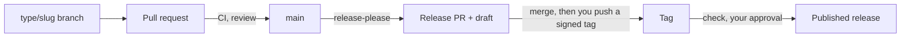

# Development lifecycle



## 1. Branches

`main` is the only long-lived branch. Everything else is short-lived and deleted after merge.

| Branch          | Use                                                                                                          |
| --------------- | ------------------------------------------------------------------------------------------------------------ |
| `main`          | Protected. Signed. Only reached through a pull request or a signed direct push by an admin.                  |
| `<type>/<slug>` | All work, pushed to GitHub. Types: `feat fix perf refactor test docs build ci chore style revert`.           |
| `claude/<slug>` | Made by Claude, **local only**. Rename it to `<type>/<slug>` before pushing; GitHub rejects any other name.  |

An urgent fix is an ordinary `fix/<slug>` branch and pull request.

## 2. Commits and pull requests

- Commits and PR titles are Conventional Commits: `type(scope): summary`. Use `!` after the type, or a `BREAKING CHANGE:` footer, for a breaking change.
- The PR title becomes the commit on `main` (squash merge, title as subject), so the title is what release-please reads. The `PR conventions` workflow checks the title and the branch name.
- Commits on a branch can be unsigned. The squash merge makes one commit that GitHub signs.

## 3. Continuous integration

| Workflow       | Trigger                | What it does |
| -------------- | ---------------------- | ------------ |
| `ci.yml`       | every PR, push to main | Runs the repo's gates behind one command |
| `pr-title.yml` | PR opened or edited    | Conventional Commits title and `<type>/<slug>` branch name |
| `release.yml`  | push to main, tag push | A push to main keeps the release PR and draft current; a tag push checks the tag, waits for your approval, builds and publishes the draft |

CI does not run on the release PR, because pull requests opened with `GITHUB_TOKEN` start no workflows. The same commits have already passed CI on `main`, and the release job builds before it publishes anything.

## 4. Releases

[release-please](https://github.com/googleapis/release-please-action) reads the Conventional Commit subjects on `main` since the last release and keeps one pull request open, titled `chore(main): release x.y.z`, plus a **draft** release with the notes. It creates **no tag**. The version bump is standard semver:

| Commit types                                     | Version change |
| ------------------------------------------------ | -------------- |
| `feat`                                           | minor          |
| `fix`                                            | patch          |
| `feat!`, `fix!`, or a `BREAKING CHANGE:` footer  | major          |
| anything else (`docs`, `test`, `ci`, `chore`, …) | no release     |

The release PR updates the version files listed in `release-please-config.json` and `CHANGELOG.md`.

### Cut a release

1. Merge PRs as usual. The release PR and the draft update themselves after each push to `main`.
2. When you want to ship, review the release PR and squash-merge it.
3. Create the tag yourself, signed, on the release commit, and push it (one YubiKey tap):
   ```bash
   git switch main && git pull --ff-only
   git tag -s x.y.z -m x.y.z && git push origin x.y.z
   ```
4. The tag push starts the **Release** workflow:
   - **check**: the tag is annotated and signed, its commit is on `main`, and the version files match the tag.
   - **release**: waits for your approval in GitHub (environment `release`), then builds, attests and attaches the release files (fill in the `release` job), and publishes the draft.

**Why the tag is yours.** A tag is signed when it is created, so a bot cannot make one that you then sign, and GitHub does not sign tags for you. A tag made with `GITHUB_TOKEN` also starts no workflow. The tag rules have no exemption: every tag must be signed and only admins can create one, so a release always needs your hardware signature and your approval.

To force a version, merge a commit whose body has the line `Release-As: x.y.z`.

### If something goes wrong

- **No release PR appears:** only `docs`, `test`, `ci` and other non-releasing commits landed since the last release.
- **release-please stops opening release PRs:** it refuses while a merged release PR still carries the `autorelease: pending` label. With `draft: true` it should flip that label to `tagged` itself; if it did not, flip it by hand.
- **`check` fails:** the tag is lightweight, unsigned, or not on `main`. An admin deletes it (`git push origin --delete x.y.z && git tag -d x.y.z`) and you create it again with `git tag -s`.
- **The release job fails after you approved:** re-run it. Attaching files uses `--clobber` and publishing a draft twice is harmless.
- **A bad release:** fix forward with the next patch.

## 5. Collaboration

Right now collaboration means opening pull requests.
- **Anyone** can fork a public repo and open a PR from the fork. Workflows run for a fork's PR with a read-only token and no secrets, and GitHub holds a first-time contributor's runs until you approve them.
- **An invited collaborator** can push a `<type>/<slug>` branch to this repo and open a PR.
- `claude/*` branches are local only; GitHub rejects them for everyone.
- Only the owner merges, and only the owner can create a tag, so only the owner can release. Contributors do not need to sign commits.

## 6. How `main` is protected (repository rulesets)

The rules come from the workstation repo (`github/rulesets/`) and are applied with `just github repo --harden owner/repo`.

- **Squash merge only.** Merge commits and rebase merges are off, and the commit subject is the PR title.
- **Signed commits.** Every commit on `main` is verified. A direct push needs the maintainer's hardware-key signature. An admin may merge a pull request even when its branch commits are unsigned, because the squash commit is signed by GitHub.
- **Required checks.** The CI jobs must pass before merging. The admin can bypass this on purpose, which is also how release PRs (they run no CI) are merged.
- **Only admins update `main`**, nobody deletes it, and only admins force-push.
- **Branch names.** GitHub rejects any branch that is not `main`, `<type>/<slug>` or `release-please--*`.
- **Tags.** Every tag must be signed, with no exemption, and only admins create or delete them. release-please never creates one.
- **Actions are pinned and restricted.** Every `uses:` is a full commit SHA with its tag in a trailing comment, GitHub requires that, and only GitHub-owned actions plus the ones this repo's workflows use are allowed. `just github repo --pin <dir>` pins a new reference and refreshes moved ones.
- **The release job needs your approval.** It runs in the `release` environment, usable from `main` and tags only, with you as the required reviewer.
- **Actions token.** `GITHUB_TOKEN` is read-only by default and may open pull requests, so release-please can open its release PR.
